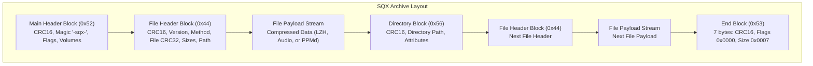
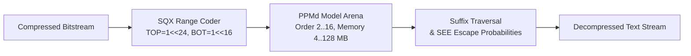

# Squeez SQX Archive Format & Codec Specification (v1.1 & v2.0)

**Author:** Native C reverse-engineering and reimplementation by [seb3773](https://github.com/seb3773)  
**Historical Origin:** Sven Ritter / SQX Development (1993–2008)  
**Status:** Complete, reverse-engineered specification covering container versions 1.1 and 2.0, codecs 0–6, multimedia transforms, and audio predictors.  
**Legal Notice:** This reverse-engineering work was conducted strictly for the purposes of software interoperability and digital data preservation (under European Directive 2009/24/EC) to reconstruct the container structures, prediction filters, and entropy decoding/encoding algorithms of an obsolete historical archive format.

---

## 1. Architectural Overview

SQX is a high-performance, block-based general-purpose archive format developed by Sven Ritter. It features a versatile container architecture supporting **solid archive streaming**, **in-place block verification**, and multiple domain-specific compression engines (LZH, PPMd, multi-channel delta filters, and dedicated audio codecs).

Unlike formats that maintain an isolated global index file (e.g. AIN or 7z), SQX streams structured header blocks sequentially. Every archive begins with an archive main block (`0x52`), followed by an alternating sequence of file headers (`0x44`), directory blocks (`0x56`), raw/compressed payload streams, and optional recovery records (`0x58`), terminated by an end-of-archive marker (`0x53`).



### Version Distinction: SQX 1.1 vs SQX 2.0

A foundational finding of this reverse engineering effort is that **the container structure is identical between SQX 1.1 and 2.0**. The archive version is **not** specified in the main block (where `cArcerVer` is fixed to `11`), but is declared individually inside each file header block via `cArcerExVer`:
- `0x0B` (11 decimal) indicates **SQX 1.1**.
- `0x14` (20 decimal) indicates **SQX 2.0**.

Differences between versions 1.1 and 2.0 manifest primarily in codec implementations (extended LZH alphabets, 32 MB dictionary addressing, PPMd method 6, and mode-1 FIR audio filters).

---

## 2. Container & Block Hierarchy

Every block in an SQX archive begins with a mandatory 7-byte generic block header. All integer fields are stored in **little-endian** byte order.

### 2.1 Generic Block Header (7 bytes)

| Byte Offset | Size | Type | Field Name | Description |
|---|---|---|---|---|
| `0x00..0x01` | 2 | `uint16 LE` | `usHeadCRC` | Block CRC16 checksum calculated over `[0x02 .. usHeadSize - 1]` |
| `0x02` | 1 | `uint8` | `cHeadType` | Block type identifier |
| `0x03..0x04` | 2 | `uint16 LE` | `usHeadFlags` | Block-specific flags |
| `0x05..0x06` | 2 | `uint16 LE` | `usHeadSize` | Total size of block header in bytes (including the 7-byte header) |
| `0x07..` | var | bytes | `payload` | Block-specific metadata payload of `(usHeadSize - 7)` bytes |

#### Block CRC16 Calculation

The block checksum is computed using the standard reflected CRC32 polynomial `0xEDB88320`. The block CRC16 corresponds to the **lower 16 bits of the un-inverted raw CRC32 accumulator**:

```c
uint16_t sqx_block_crc16(const uint8_t *data, size_t len) {
    uint32_t crc = 0xFFFFFFFFu;
    for (size_t i = 0; i < len; i++) {
        crc = crc32_table[(crc ^ data[i]) & 0xFF] ^ (crc >> 8);
    }
    return (uint16_t)(crc & 0xFFFFu);
}
```

The checksum is evaluated over all bytes of the header starting from byte `0x02` (`cHeadType`) through byte `usHeadSize - 1`.

#### Standard Block Types

| Type Value | ASCII | Constant Name | Description |
|---|---|---|---|
| `0x52` | `'R'` | `SQX_BLOCK_MAIN` | Archive Main Header (archive magic, volume parameters) |
| `0x44` | `'D'` | `SQX_BLOCK_FILE` | File Header (file attributes, compression method, original/compressed sizes) |
| `0x56` | `'V'` | `SQX_BLOCK_DIR` | Directory Header (hierarchical directory metadata) |
| `0x53` | `'S'` | `SQX_BLOCK_END` | End of Archive Header (terminator marker) |
| `0x43` | `'C'` | `SQX_BLOCK_COMMENT` | Archive or File Comment Record |
| `0x58` | `'X'` | `SQX_BLOCK_RECOVERY` | Recovery Record (`"SQ4RD"` Reed-Solomon parity) |
| `0x41` | `'A'` | `SQX_BLOCK_AUTH` | Authenticity Verification Record |
| `0x49` | `'I'` | `SQX_BLOCK_INTERNAL` | Vendor Internal Extension Block |

---

### 2.2 Archive Main Header (`0x52`)

The main archive block establishes archive identity and global attributes. Its total header size is typically 25 bytes (`usHeadSize = 0x0019`):

| Offset | Size | Type | Field Name | Description |
|---|---|---|---|---|
| `0x00..0x01` | 2 | `uint16 LE` | `usHeadCRC` | Block CRC16 |
| `0x02` | 1 | `uint8` | `cHeadType` | Constant `0x52` (`'R'`) |
| `0x03..0x04` | 2 | `uint16 LE` | `usHeadFlags` | Global flags (Bit 2: Solid archive, Bit 1: Encrypted headers, Bit 3: Multi-volume) |
| `0x05..0x06` | 2 | `uint16 LE` | `usHeadSize` | Header size (constant `0x0019` = 25 bytes) |
| `0x07..0x0B` | 5 | ASCII | `szMagic` | Archive signature: `"-sqx-"` |
| `0x0C` | 1 | `uint8` | `cArcerVer` | Archive writer base version (always `0x0B` = 11 decimal) |
| `0x0D..0x0E` | 2 | `uint16 LE` | `usArcVolNum` | Multi-volume fragment number (`0` for standalone archive) |
| `0x0F..0x12` | 4 | `uint32 LE` | `u32ArcVolId` | Volume set identification number |
| `0x13..0x18` | 6 | bytes | `reserved` | 3 $\times$ `uint16 LE` reserved (`0x0000`) |

---

### 2.3 File Header Block (`0x44`)

The file header defines the attributes and compression parameters of the subsequent file payload:

| Offset | Size | Type | Field Name | Description |
|---|---|---|---|---|
| `0x00..0x01` | 2 | `uint16 LE` | `usHeadCRC` | Block CRC16 over `[0x02 .. 0x2A + FileNameLen]` |
| `0x02` | 1 | `uint8` | `cHeadType` | Constant `0x44` (`'D'`) |
| `0x03..0x04` | 2 | `uint16 LE` | `usHeadFlags` | File flags (see breakdown below) |
| `0x05..0x06` | 2 | `uint16 LE` | `usHeadSize` | Total size of block header up to and including `szFileName` |
| `0x07` | 1 | `uint8` | `cCompFlags` | Bit 0: Extended compressor header present in data stream |
| `0x08..0x09` | 2 | `uint16 LE` | `usExtraFlags` | Reserved / extra format flags (`0x0000`) |
| `0x0A` | 1 | `uint8` | `cOsFilesys` | Origin Host OS (`0x14` = 20: Windows NTFS) |
| `0x0B` | 1 | `uint8` | `cArcerExVer` | **Archiver Version**: `0x0B` (11) = SQX 1.1; `0x14` (20) = SQX 2.0 |
| `0x0C` | 1 | `uint8` | `cArcMethod` | Compression method: `0` (Stored), `1..4` (LZH), `5` (Audio), `6` (PPMd), `7` (Ultra) |
| `0x0D..0x10` | 4 | `uint32 LE` | `u32FileCRC32` | Standard CRC32 of original file payload (reflected polynomial, inverted final XOR) |
| `0x11..0x14` | 4 | `uint32 LE` | `u32FileAttr` | Standard DOS/Windows file attributes (`0x20` Archive, `0x80` Normal) |
| `0x15..0x18` | 4 | `uint32 LE` | `u32FileTime` | Standard MS-DOS bit-packed timestamp |
| `0x19..0x1C` | 4 | `uint32 LE` | `u32CompSize` | Size of compressed data stored in archive |
| `0x1D..0x20` | 4 | `uint32 LE` | `u32OrigSize` | Original uncompressed size of file |
| `0x21..0x28` | 8 | `uint64 LE` | `u64Sizes` | Optional 64-bit sizes `[u32CompSizeHigh, u32OrigSizeHigh]` (only if flag bit 7 is set) |
| `0x29..0x2A` | 2 | `uint16 LE` | `usFileNameLen` | Length of file path in bytes |
| `0x2B..` | var | string | `szFileName` | Relative file path (ANSI/ASCII, forward slash or backslash) |

#### File Header Flags (`usHeadFlags`)

| Bit Position | Mask | Name | Description |
|---|---|---|---|
| Bit 1 | `0x0002` | `SQX_FILE_ENCRYPTED` | Payload stream is encrypted |
| Bit 2 | `0x0004` | `SQX_FILE_SOLID` | File continues solid dictionary state from previous file |
| Bit 3 | `0x0008` | `SQX_FILE_PREV_VOL` | Continuation from previous multi-volume slice |
| Bit 4 | `0x0010` | `SQX_FILE_NEXT_VOL` | Continues onto next multi-volume slice |
| Bit 5 | `0x0020` | `SQX_FILE_COMMENT` | File comment follows header |
| Bit 6 | `0x0040` | `SQX_FILE_ASCII` | Filename encoded in standard ASCII/ANSI |
| Bit 7 | `0x0080` | `SQX_FILE_SIZE64` | 64-bit size fields present at offset `0x21` |
| Bits 8..10 | `0x0700` | `SQX_FILE_DICMASK` | Base dictionary size index: `32 KB << index` (range 32 KB .. 4 MB) |
| Bit 11 | `0x0800` | `SQX_FILE_DICEXT` | **SQX 2.0 Extended Dictionary**: `8 MB << index` (range 8 MB .. 32 MB) |
| Bit 15 | `0x8000` | `SQX_FILE_LINKED` | Linked metadata sub-blocks follow |

Directly after `szFileName`, the file data payload begins immediately and spans exactly `u32CompSize` bytes.

---

### 2.4 Directory Block (`0x56`) and End Block (`0x53`)

#### Directory Block (`0x56`)
Directory blocks store intermediate directory metadata without data payloads:
- `0x00..0x06`: 7-byte Generic Block Header (`cHeadType = 0x56`).
- `0x07..0x0A` (4 bytes): `u32DirAttr` (DOS directory attributes, e.g. `0x10`).
- `0x0B..0x0E` (4 bytes): `u32DirTime` (DOS timestamp).
- `0x0F..0x10` (2 bytes): `usDirNameLen` (length of directory path).
- `0x11..`: `szDirName` (directory path string).

#### End of Archive Block (`0x53`)
The archive terminator consists of a constant 7-byte block with zero flags and size 7:
```
3E 2B 53 00 00 07 00
```
- `usHeadCRC = 0x2B3E`
- `cHeadType = 0x53` (`'S'`)
- `usHeadFlags = 0x0000`
- `usHeadSize = 0x0007`

---

### 2.5 Self-Extracting (SFX) Executable Detection

Windows self-extracting executables consist of a 32-bit PE extractor stub followed immediately by a valid SQX archive. Because the PE stub code and resources may embed the string `"-sqx-"` internally, reliable archive discovery must locate a `0x52` block header whose CRC16 matches:

| Format Version | Observed Typical PE Stub Size | Search Algorithm |
|---|---|---|
| **SQX 1.1 SFX** | ~80,669 bytes | Linear scan starting at offset 64 KB, searching for `"-sqx-"` at offset `+7` with valid `usHeadCRC` |
| **SQX 2.0 SFX** | ~94,493 bytes | Linear scan starting at offset 80 KB, searching for `"-sqx-"` at offset `+7` with valid `usHeadCRC` |

---

## 3. Codec Specifications

### 3.1 Bitstream Reading Engine (`sqx_bits`)

SQX compressed streams are bit-oriented and unaligned. Bits are packed into a 32-bit register `uBitBuf` from memory in **32-bit little-endian dwords**, but bits are consumed **from most significant bit (MSB) to least significant bit (LSB)** within the register.

```c
typedef struct {
    const uint8_t *src;
    size_t         len;
    size_t         pos;
    uint32_t       buf;   /* 32-bit bit register */
    unsigned       bits;  /* Number of valid bits in buf */
} sqx_bits;
```

---

### 3.2 Methods 1–4: LZH Compression Engine

Methods 1 through 4 utilize an LZ77 sliding window dictionary combined with dynamic canonical Huffman coding:
- Method 1: Fast compression
- Method 2: Normal compression
- Method 3: High compression
- Method 4: Best compression

#### Block Structure & Header Parsing (`ReadTabs`)

The compressed stream is divided into independent or linked Huffman blocks. Each block begins with a variable-length bit header:

| Bits Read | Field Name | Description |
|---|---|---|
| 1 bit | `is_mm` | `0` = LZ block; `1` = Multimedia block (range-coded) |
| 15 bits | `uBTBlockPtr` | Number of tokens/symbols in this block |
| 1 bit | `four_trees` | `0` = 3 Huffman trees; `1` = 4 Huffman trees |
| If `four_trees == 0`: 1 bit | `extra_scheme` | Single tree length encoding flag |
| If `four_trees == 1`: 9 bits | `border` | Split boundary separating Tree #1 into Subtree #1a and #1b |
| 19 $\times$ 4 bits | `meta_lens` | Code lengths (0..15) for the 19-symbol meta-Huffman tree |
| Compressed Table Bits | `tree_lens` | Canonical Huffman code lengths for the primary trees |

#### Alphabets: SQX 1.1 vs SQX 2.0

The literal/length and distance alphabets differ between versions:

```
Alphabet Comparison:
┌──────────────────────────────┬──────────────────────────────┐
│ SQX 1.1 (cArcerExVer = 11)   │ SQX 2.0 (cArcerExVer = 20)   │
├──────────────────────────────┼──────────────────────────────┤
│ Tree #1: 310 codes           │ Tree #1: 311 codes           │
│   0..255   : Literals        │   0..255   : Literals        │
│   256      : Copy last match │   256      : Copy last match │
│   -        : -               │   257      : Copy @ cur dist │
│   257..260 : 4 Repeat offsets│   258..261 : 4 Repeat offsets│
│   261..268 : Length 2 (8)    │   262..269 : Length 2 (8)    │
│   269..283 : Length 3 (15)   │   270..285 : Length 3 (16)   │
│   284..308 : Lengths >= 4    │   286..309 : Lengths >= 4    │
│   309      : Long match 14b  │   310      : Long match 14b  │
│                              │                              │
│ Tree #2: 25 Repeat lens      │ Tree #2: 25 Repeat lens      │
│ Tree #3: 56 Distance codes   │ Tree #3: 54 Distance codes   │
│ Tree #4: None                │ Tree #4: low16 (16 sub-codes)│
└──────────────────────────────┴──────────────────────────────┘
```

#### Length and Distance Constraints

1. **Distance Boundaries**:
   - Matches of length 2 are valid only up to distance `MIN_LEN2 = 255`.
   - Matches of length 3 are valid only up to distance `MIN_LEN3 = 16,383` (1.1) or `32,767` (2.0).
   - Matches of length 4 are valid only up to distance `MIN_LEN4 = 262,143`.
   - Maximum match length is `16,640` bytes.

2. **Length Corrections**:
   - In **SQX 1.1**: If repeat distance $> \text{MIN\_LEN3}$, length is incremented by 1; if $> \text{MIN\_LEN4}$, length is incremented by an additional 1. Ordinary matches at distance $> \text{MIN\_LEN4}$ receive $+1$ length compensation.
   - In **SQX 2.0**: Only a single length compensation exists at distance $> \text{0x7FFF}$ ($+1$ length). The historical $\text{MIN\_LEN4}$ correction is abolished.

3. **SQX 2.0 `low16` Distance Sub-table**:
   In SQX 2.0, if the distance requires $\ge 4$ extra bits and the optional `low16` table is present, the lowest 4 bits of the distance offset are encoded via the 16-entry `low16` Huffman tree rather than as raw bits.

---

### 3.3 Method 5: Audio Compression Engine

Method 5 provides dedicated lossless predictive coding for 8-bit and 16-bit mono and stereo PCM audio (`.WAV`).

#### 18-Byte Audio Stream Header (`SQX_AUDIO_HEAD`)

Every audio stream begins with an uncompressed 18-byte stream header:

| Offset | Type | Field Name | Description |
|---|---|---|---|
| `0x00..0x03` | `uint32 LE` | `lSkipSize` | Uncompressed leading WAV/RIFF header bytes (e.g. 44) |
| `0x04..0x07` | `uint32 LE` | `lFileTail` | Trailing non-audio bytes copied as-is |
| `0x08..0x0B` | `uint32 LE` | `uRawDataSize` | Total byte size of compressed audio samples |
| `0x0C` | `uint8` | `cChannels` | Number of audio channels (`1` = mono, `2` = stereo) |
| `0x0D` | `uint8` | `cChannelBits` | Bit resolution (`8` = 8-bit unsigned, `16` = 16-bit signed) |
| `0x0E..0x11` | 4 bytes | `reserved` | Padding and extra parameter fields (`0x00000000`) |

> [!IMPORTANT]
> **Audio CRC32 Calculation**: In SQX, the archive file CRC32 for an audio file is computed over the **18-byte internal audio header followed by the complete decoded PCM file**.

---

#### Audio 1.1 Specification

- **8-Bit Codec**:
  - Samples are decomposed using 6 polynomial delta predictors:
    $$P_0 = 0,\quad P_1 = s_0,\quad P_2 = 2s_0 - s_1,\quad P_3 = 3s_0 - 3s_1 + s_2$$
    $$P_4 = (4s_0 - 3s_1 + s_2) \gg 1,\quad P_5 = 4s_0 + 6s_1 - 4s_2 + s_3 \pmod{256}$$
  - Predictors adapt periodically (every 1023 samples in mono, 511 in stereo) by selecting the predictor with the minimum non-zero error residuals.
  - Residuals are encoded via dynamic Huffman trees refreshed every 14-bit block.
- **16-Bit Codec**:
  - Streams are organized into frames of 384 samples.
  - Frame header: 1-bit `head` flag (if `1`, explicit 11-bit frame size follows; otherwise fixed 384).
  - Stereo channels apply `icd` difference interleaving:
    - `icd = 0`: Raw left and right $[L, R]$.
    - `icd = 1`: Difference $R \leftarrow R - (L \gg 1);\; L \leftarrow L + R$.
    - `icd = 2`: Difference $R \leftarrow R - (L \gg 1);\; L \leftarrow L + (R \gg 1)$.
  - Residuals are predicted via 5 polynomial predictors and coded using unary quotients with fixed-width shifts.

---

#### Audio 2.0 Specification

SQX 2.0 modernizes the audio engine with advanced linear predictive coding and entropy range coding:

##### 1. 8-Bit Audio 2.0 Codec
Frameless symbol stream processed by a carryless range coder:
- Context model: 256 contexts (determined by previous byte) $\times$ 17 sub-models $\times$ 16 symbols.
- Each decoded byte passes through an adaptive 6-case delta predictor.

##### 2. 16-Bit Audio 2.0 Codec
Frames consist of 4608 samples. Each frame header provides:
- 1-bit `head` (if `1`, explicit 13-bit frame length follows; otherwise 4608).
- 2-bit stereo interleaving index `icd`:
  - `icd = 0`: $[L, R]$
  - `icd = 1`: $A = L,\quad B = (int16)(L - R)$
  - `icd = 2`: $A = R,\quad B = (int16)(L - R)$
  - `icd = 3`: $A = \frac{L + R - ((L - R) \& 1)}{2},\quad B = L - R$
- Per channel, a 1-bit mode selector:
  - **Mode 0 (Polynomial Predictors)**: 3-bit predictor index (polynomials 0..3 or adaptive 5th predictor), 1-bit Rice flag, followed by fixed-width or adaptive Rice-encoded residuals.
  - **Mode 1 (Adaptive FIR Filter)**:
    1. Pre-filter $B^{-1}$: $v[i] = smp[i] - ((3 \cdot v[i-1]) \gg 2)$.
    2. Autocorrelation $r[0..11]$: Emulates x86 32-bit truncated multiplication $\sum \text{int32}(pre[i] \cdot pre[i-k])$ accumulated into 64 bits.
    3. Levinson-Durbin algorithm in double precision to determine optimum filter order ($1..11$).
    4. Coefficient quantization via `frexp(max |a|)`.
    5. Filter shift evaluation and chained $A^{-1}$ recursion: $res[i] = v[i] - (res[i-1] \gg 1)$.
    6. Residual body encoded via adaptive Rice coding.

##### 3. Bit-Exact Fidelity & Correction of Legacy Windows DLL Flaw (`x_altst16`)

This native C implementation produces compressed audio streams that are **100% bit-exact (byte-for-byte identical)** to the original Windows reference archiver (`sqx20u.dll` / `sqc.exe`) across all valid audio inputs (standard corpora, impulsive noise, unaligned lengths, silence, DC, and full-scale ramps), with **100% lossless round-trip fidelity**.

> [!NOTE]
> **Correction of Critical Legacy DLL Flaw (`x_altst16`)**: On adversarial alternating stereo fixtures ($\pm 32,767$ in anti-phase), the original reference archiver / Windows DLL (`sqx20u.dll` / `sqc.exe`) encounters an internal numerical overflow in its FIR pipeline when combined with stereo interleaving `icd = 3` (32-bit expanded difference values). The legacy DLL destabilizes and generates a corrupted, pathological **603 MB** archive from a 36 KB audio sample.

###### Mathematical Mechanism of the Legacy Flaw
1. **Anti-phase alternating stereo**: Input channels alternate between $+32,767$ and $-32,768$ in anti-phase ($L = [+, -, +, -], R = [-, +, -, +]$).
2. **Channel difference expansion**: Under stereo interleaving `icd = 3`, the channel difference $B = L - R$ produces alternating differences of $\pm 65,535$, exceeding standard 16-bit dynamic range into 32-bit signed space.
3. **Pre-filter geometric divergence**: The FIR pre-filter $B^{-1}$ ($v[i] = smp[i] - ((3 \cdot v[i-1]) \gg 2)$) applied to an alternating series of magnitude $65,535$ grows geometrically.
4. **Truncated 32-bit autocorrelation**: The reference DLL computes autocorrelation via 32-bit x86 signed multiplication:
   $$r[k] = \sum_{i} \text{int32}(pre[i] \cdot pre[i-k])$$
   As the series expands, intermediate products immediately wrap around 32-bit signed integer boundaries, resulting in massive sign inversions and corrupted $r[k]$ vectors.
5. **Encoder loop runaway**: While the Levinson-Durbin solver attempts order reduction, the legacy archiver fails to fall back safely under `icd = 3`, entering a catastrophic emission loop that outputs **603,000,000+ bytes** before aborting or terminating.

###### Reimplementation Fix & Interoperability
- **The Native C Correction**: This native C reimplementation explicitly **corrects** this legacy defect. Candidate predictor costs are evaluated cleanly, runaway FIR branches are rejected, and a healthy, compliant **~23 KB** stream (23,304 bytes) is emitted.
- **Official Oracle Verification**: Crucially, **this ~23 KB stream is decompressed without error (`CRC OK!`) by the official reference extractor `sqc x` itself**. Full backward interoperability is preserved: legacy users can unpack archives produced by this reimplementation using standard official SQX tools without risking disk-space exhaustion.
- **Architectural Rationale**: This legacy flaw is intentionally **fixed**, not replicated. A bug is not a format specification. Intentionally reproducing an internal engine runaway that creates corrupted multi-hundred-megabyte archives on disk would be absurd and counterproductive.

---

### 3.4 Method 6: Text Compression Engine (PPMd)

Method 6 implements Dmitry Shkarin's **PPMd variant I** (corresponding to `Ppmd8` in 7-Zip), driven by the SQX carryless range coder:



#### Bitstream Header
- `cont` (1 bit): `0` = New model initialization; `1` = Model continuation from previous file (solid mode).
- If `cont == 0`:
  - `order` (8 bits): Model context order ($2..16$, default 6 for `sqc`, 8 for GUI).
  - `mem_mb` (10 bits): Arena allocation memory in MB ($4..128$, default 32 MB).

#### Range Coder Primitives
The range coder maintains registers `rc_low`, `rc_range`, and `rc_code`:
- Normalization thresholds: `RC_TOP = 0x01000000` ($2^{24}$), `RC_BOT = 0x00008000` ($2^{15}$).
- Flush sequence: High byte of `rc_low` emitted sequentially, terminating with 4 bytes of `rc_low`.

---

### 3.5 Multimedia (MM) Transform & Fenwick Range Coder

When `is_mm == 1` in an LZH block, the payload is decoded through a multi-channel range coder followed by an adaptive delta filter.

#### MM Block Header (23 bits)
$$\text{type}(1) \mid \text{base}(1) \mid \text{start}(3) \mid \text{ndelta}(2) + 1 \mid \text{nentropy}(2) + 1 \mid \text{bt}(15)$$
- `ndelta`: Number of delta transform channels ($1..4$).
- `nentropy`: Number of interleaved range coder models ($1..4$).
- `bt`: Block payload token count.

#### Fenwick Tree Cumulative Frequency Model
The range coder utilizes a Fenwick binary indexed tree:
- Alphabet size: 256 symbols.
- Initial frequency: `incr = 8` per symbol (`tot_freq = 2048`).
- Adaptation: `tot_freq` capped at `max_freq = 4096`; rescaled via $f \leftarrow f - (f \gg 1)$.
- Search: Binary descent utilizing power-of-two mask (128).

#### Delta Inversion (`DeconvRType`)
Inverted per channel using 5 predictor tables. In both SQX 1.1 and 2.0, the delta filter model resets with an initial adaptation frequency of `0xFF` (255) at the beginning of each MM block.

---

## 4. Technical Comparison: SQX 1.1 vs SQX 2.0

| Feature | SQX 1.1 (`cArcerExVer = 11`) | SQX 2.0 (`cArcerExVer = 20`) |
|---|---|---|
| **Max Dictionary Size** | 4 MB (128 KB .. 4096 KB) | **32 MB** (extended flag bit 11) |
| **LZH Litlen Symbols** | 310 codes | **311 codes** (symbol 257 copy, 285 len-3) |
| **LZH Distance Symbols** | 56 codes | **54 codes** |
| **Distance Sub-table** | None | **`low16` 4-bit sub-table** |
| **Distance Corrections** | Multi-level (`MIN_LEN3`, `MIN_LEN4`) | **Single threshold (`0x7FFF`)** |
| **Method 5 (Audio)** | Polynomial deltas + Huffman / Rice | **Adaptive Levinson-Durbin FIR + 256-ctx 8-bit** |
| **Method 6 (Text)** | Not supported | **PPMd var. I (Order 2–16, 4–128 MB)** |
| **Method 7 (Ultra)** | Not supported | LZ77 + Probabilistic Range Coder |
| **Solid Compression** | Supported (shared sliding window) | Supported (shared dictionary & PPMd arena) |
| **Container & CRC** | Block header CRC16 + Payload CRC32 | Identical container and checksum specs |
